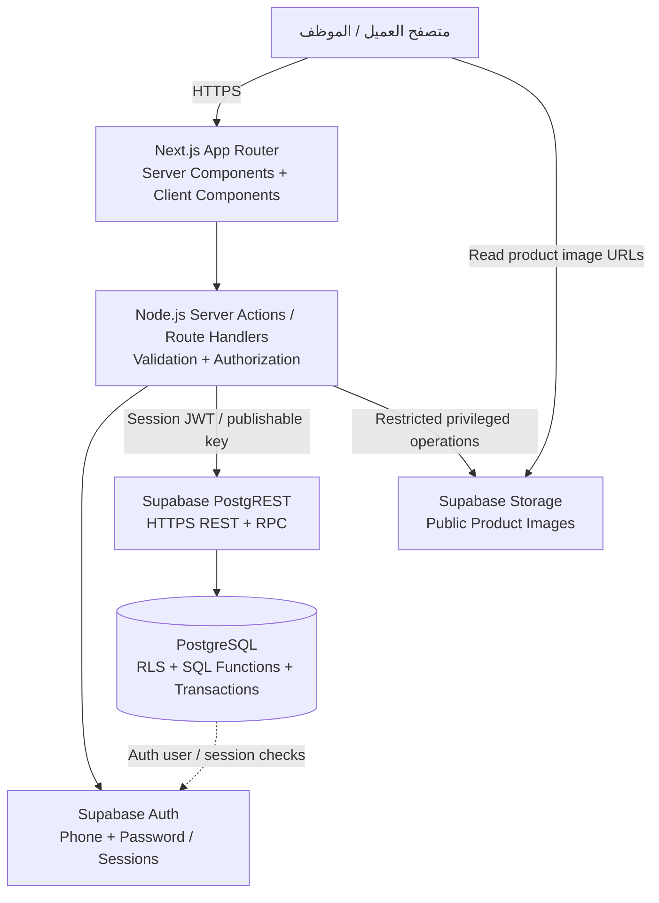
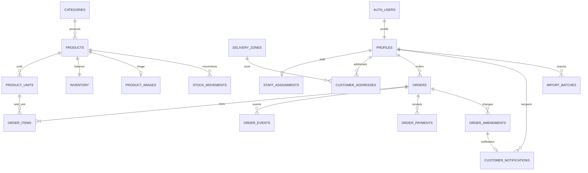
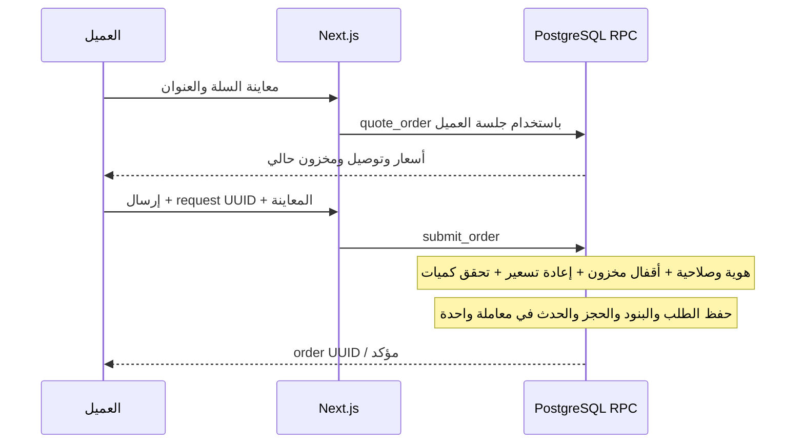
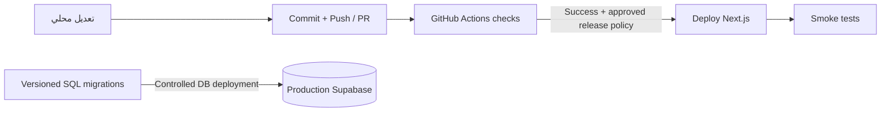

# Al-Ferdous Wholesale — Architecture & Hosting Brief

متابعة التنظيف 030: الصلاحيات المتقاعدة محذوفة من الأدوار والاستجابات الحالية ومرفوضة عند الحفظ. قائمة المنتجات والتفاصيل تعرض العلم بصلاحية catalog.read؛ تعديله ما زال يتطلب catalog.write ونسخة حديثة. الاستيراد الجديد يجعل المنتج متوفرًا افتراضيًا، والموجود يحافظ على علمه. التصديرات تميز العلم اليدوي عن أهلية الطلب. الأقسام القديمة التالية سجل تصميم سابق؛ دليل التشغيل وadmin.md يصفان التشغيل الحالي.

تغيير المتطلبات في ٣١ أكتوبر ٢٠٢٦: الترحيل 028 والتنفيذ المكتوب يستبدلان إدارة أرصدة المخزون بتوافر يدوي لكل منتج. لا حجز أو خصم أو إعادة كميات مخزن، ولا شرط كفاية أو تقادم رصيد. كميات الفاتورة والمرتجع وأسعارها تبقى محسوبة خادميًا، مع تحقق التوافر عند الطلب وزيادة الأصناف ومفاتيح منع التكرار وأقفال المنتج والطلب. تُحفظ جداول المخزون السابقة للتاريخ دون وصول تشغيلي أو إنشاء أرصدة جديدة. موافقة صاحب النظام تلغي متطلب حجز آخر كمية السابق؛ الطلبان المتزامنان على منتج متوفر مسموحان. طُبق الترحيلان 028 و029 على Supabase المحلي، وتحقق ثبات الفواتير والسجلات السابقة. المعاينة الجارية محدثة؛ راجع رأس test-report.md لنتائج التشغيل والإعادات وحدود النشر. وصف المخزون في الأقسام الأقدم أدناه تاريخي حتى إعادة مراجعة وثيقة الاستضافة النهائية.

تاريخ التحديث: ٣٠ أكتوبر ٢٠٢٦. المصدر: الكود المحلي وpackage.json وترحيلات SQL من 001 إلى 027. لا يتضمن أسرارًا أو بيانات عملاء أو ادعاء سعة لم تُقَس. الدخول منفصل: موبايل للعملاء، وبريد موثق للإدارة مع TOTP. إتمام ربط المالك الحقيقي وإلزام MFA العام وإثبات إعدادات الاستضافة والنسخ البعيد ما زالت مهام نشر مفتوحة.

إضافات 024–027: موعد توصيل تديره الإدارة بتوقيت القاهرة، توصيل مجاني لكل المناطق والطلبات الجديدة، إلغاء العميل قبل التجهيز، مرتجعات مع اعتماد الإدارة وإعادة المخزون وتعديل الفاتورة في معاملة واحدة. جدول order_returns يحتفظ بطلب المرتجع وقراره ونسخ قبل/بعد؛ order_items يحتفظ بالكمية المتبقية وreturned_quantity. اعتماد المرتجع ينشئ رصيدًا مستحقًا للعميل عند وجود زيادة في المحصل، ولا يسجل رد نقد وهميًا. الحجز والإلغاء والتجهيز والمرتجعات تتسلسل بأقفال السجلات وفحص النسخة ومفاتيح منع التكرار.

الفاتورة المحمية من /invoices/[id] للطباعة، ومن /invoices/[id]/pdf للتنزيل باستخدام jsPDF 4.2.1 وخط Amiri محلي مرخّص OFL ومدرج بتتبع ملفات البناء. التصدير الكامل للعملاء والمنتجات من /admin/reports/export يستخدم ExcelJS streaming وصفحات مؤشر UUID بحجم 500 عميل أو 200 منتج؛ لا يحمّل جميع الصفوف في مصفوفة واحدة ولا يقف عند حد 1000. لكل وحدة بيع صف بنفس مخزون المنتج المشترك. بيانات التصدير تُقرأ أثناء التحميل وليست لقطة معاملات ثابتة. صلاحية customers.read ترى العنوان الافتراضي المحفوظ فقط، مع بقاء بقية عناوين العميل خاصة به. الملفات لا تدخل cache عام وتستهلك ميزانية التصدير المشتركة.

## 1. الصورة العامة

تطبيق طلبات جملة B2B عربي RTL لمحلات الإسكندرية. المشروع تطبيق Next.js واحد يجمع واجهة العميل ولوحة الإدارة وكود الخادم، ويتصل بمنظومة Supabase: PostgreSQL + Auth + PostgREST + Storage. النمط: تطبيق موحد مقسم بحسب مجالات العمل، مع قواعد المعاملات الحساسة داخل قاعدة البيانات. ليس مجموعة microservices، وليس واجهة static فقط، وليس backend منفصلًا بـExpress/NestJS.

الأسهم من SQL إلى Auth تعبر عن الاعتماد على جداول auth.users وauth.sessions داخل نفس PostgreSQL، وليست مكالمة شبكة من المعاملة. ملفات JavaScript/CSS والخطوط يمكن تقديمها عبر CDN؛ بيانات الحساب والأسعار الخاصة لا تُخزن في cache عام.

## 2. التقنيات الحالية

الإصدارات التالية مثبتة في package.json وقت المراجعة وليست توصية بأحدث إصدار عام:

- Next.js 16.4.3، React / React DOM 19.3.1، TypeScript 6.0.3.
- Node.js: المتطلب المعلن >=22، وCI الحالي يستخدم Node 24. النشر يفضل Node 24 بعد اختبار الحزمة على المنصة.
- Tailwind CSS 4.3.3 + CSS مشترك ومكونات مخصصة، وخط IBM Plex Sans Arabic محلي.
- Zod 4.6.7 للتحقق من مدخلات النماذج والبيانات.
- Supabase JS 2.118.0 وSSR 0.12.7، وSupabase CLI 2.122.0.
- PostgreSQL 17 مضبوط في Supabase المحلي؛ يجب التحقق من توافق نسخة المشروع السحابي عند النقل.
- Sharp 0.35.5 لمعالجة الصور على الخادم، ExcelJS 4.4.0 للاستيراد والتصدير.
- Vitest 5.0.5، PGlite 0.5.11، Playwright 1.64.1، ESLint 10.13.0.
- لا Redis ولا Elasticsearch ولا ORM مثل Prisma، ولا worker دائم في التنفيذ الحالي.

## 3. Frontend

الموقع Responsive للكمبيوتر والموبايل، وليس تطبيق Android/iOS أصليًا. معظم الصفحات Server Components لتحميل البيانات على الخادم، والمكونات التي تحتاج تفاعلًا تستخدم React Client Components.

### واجهة العميل

- `/`: الكتالوج، البحث بالاسم والكود، اقتراحات من أول حرف، أقسام، فلتر التوافر، ترتيب بالعروض أو الكود أو الاسم، ترقيم صفحات بمؤشر.
- `/register`, `/login`, `/help/password`: التسجيل والدخول وتعليمات الاسترجاع عن طريق الإدارة.
- `/account`: بيانات العميل والمحل.
- `/account/addresses`: عناوين التوصيل والمنطقة والعنوان الافتراضي.
- `/cart`: السلة، اختيار العنوان، معاينة السعر والتوصيل، إرسال الطلب.
- `/account/orders`, `/account/orders/[id]`: الطلبات والتفاصيل والتاريخ والتحصيل والتعديلات.
- `/account/notifications`: إشعارات تعديل الطلب، قبل/بعد، وتحديد كمقروء.

### لوحة الإدارة

`/admin` ثم المنتجات والأقسام والعملاء والطلبات والأسعار والمناطق والموظفون والإعدادات وExcel والتقارير وسجل التدقيق. تعديل الطلب في `/admin/orders/[id]/edit`.

### حالة المتصفح

السلة محفوظة في localStorage عبر CartProvider، وتشارك نفس البيانات مع سلة جانبية native dialog تدعم تعديل الكمية والحذف ومراجعة الطلب. بيانات minimum_quantity المحفوظة مساعدة للواجهة فقط، ويعيد SQL التحقق من الحد الفعلي. اختيار شبكة/قائمة للكتالوج محفوظ محليًا ولا يغير قراءة الخادم أو ترقيم الصفحات. هذه بيانات مساعدة قابلة للتلاعب من العميل؛ السعر والمخزون والإجمالي لا يُعتمد أي منها عند الإرسال إلا بعد إعادة الحساب على الخادم وقاعدة البيانات. جلسة الدخول في cookies؛ الأدوار والصلاحيات لا تؤخذ من localStorage.

الإشعارات تعمل polling كل ٣٠ ثانية أثناء ظهور الصفحة وعند العودة إليها، وليست WebSockets أو Supabase Realtime. البحث بالاقتراحات يستدعي API بعد توقف قصير عن الكتابة مع إلغاء النتائج القديمة.

## 4. Backend

الخادم جزء من نفس مشروع Next.js. غالبية عمليات الكتابة Server Actions، وبعض الوظائف Route Handlers. ليس مطلوبًا تشغيل خدمة backend إضافية للمشروع الحالي.

### المسؤوليات على Node.js

1. استقبال الطلب/النموذج والتحقق منه عبر Zod.
2. التحقق من جلسة العميل وصلاحية الموظف.
3. استدعاء Supabase باستخدام جلسة المستخدم في العمليات المعتادة.
4. تنسيق الملفات والصور وقراءة XLSX وتوليد التصدير.
5. تحويل أخطاء SQL إلى رسائل عربية، وإعادة التحقق من الصفحات بعد نجاح الكتابة.
6. استخدام service-role في وظائف ضيقة مثل إدارة Auth، رفع الصور الموثوقة، واستهلاك حد المحاولات؛ ليس بديلًا عامًا عن RLS.

### المسؤوليات داخل PostgreSQL

الأسعار والعروض، معاينة الطلب، حجز المخزون، انتقال الحالة، التحصيل والرد، تعديل البنود، منع تكرار العمليات، صلاحيات الصفوف، وتطبيق دفعة Excel الذري. نقل الواجهة لاستضافة مختلفة لا يلغي الحاجة لهذه الدوال.

### واجهات HTTP الصريحة

- `GET /api/search`: اقتراحات بحسب النطاق؛ نطاقات الإدارة تحتاج صلاحيات.
- `GET /api/notifications`: ملخص الإشعارات الخاص بالجلسة، دون cache مشترك.
- `GET /admin/excel/export`: تصدير XLSX وفق الصلاحية والفلاتر والمؤشر.
- بقية الكتابات تستعمل بروتوكول Next.js Server Actions، وليس REST API مستقلة موثقة لتطبيقات طرف ثالث.

### أهم RPCs

- الحسابات: `save_customer_address`, `delete_customer_address`, `save_shop_delivery_zone`, `get_staff_access`.
- الإدارة: `save_admin_reference`, `save_admin_product`, `save_admin_unit`, `archive_admin_product`, `set_inventory_by_unit`, `save_admin_settings`.
- البيع: `browse_catalog`, `search_suggestions`, `preview_price`, `quote_order`, `submit_order`.
- الطلبات: `admin_orders`, `transition_order`, `complete_order`, `record_payment`, `preview_order_amendment`, `amend_order`.
- الإشعارات: `notification_summary`, `mark_notification_read`.
- التشغيل: `manage_staff`, `manage_customer`, `save_role_permissions`, `complete_account_recovery`, `save_payment_settings`, `sales_report`, `preview_import`, `import_context`, `apply_import`.
- الصور والحدود: `commit_product_image`, `consume_auth_limit`؛ صلاحيات التنفيذ أضيق من الدوال العامة المعتادة.

## 5. قاعدة البيانات: الجداول المنفذة

القائمة التالية وصف منطقي لأهم الحقول والعلاقات؛ DDL الكامل، والقيود والفهارس والدوال والسياسات الفعلية موجودة في `supabase/migrations/`. معظم المعرفات UUID، مع أرقام متسلسلة لبعض السجلات.

### الهوية والصلاحيات

- **auth.users / auth.sessions:** جداول تديرها Supabase Auth، وليست جداول كلمات مرور نكتبها نحن. جلسات JWT ترتبط بالهوية والجلسة الفعلية.
- **profiles:** id مرتبط بالمستخدم؛ phone فريد؛ full_name وshop_name وdelivery_address وarea وdelivery_notes وactive وcreated_at. لا كلمة مرور هنا.
- **staff_assignments:** user_id مفتاح مرتبط بالملف، role، active، created_at. الأدوار: OWNER / MANAGER / ORDER_STAFF / VIEWER.
- **role_permissions:** مفتاح مركب role + permission. المالك يملك صلاحيات خاصة، وبقية الأدوار تقيدها الدوال والسياسات؛ توجد حواجز تمنع تصعيد المشاهد.

### المحل والتوصيل

- **delivery_zones:** id، اسم فريد، fee_piastres، active، revision.
- **customer_addresses:** id، customer_id، zone_id، address، notes، is_default، from_profile، created_at. فهرس جزئي يمنع أكثر من عنوان افتراضي للعميل.
- **store_settings:** سجل واحد؛ حد المجاني، ساعات تقادم المخزون، سياسة block/warn، revision.
- **payment_settings:** سجل واحد؛ بيانات مستلم InstaPay العامة وrevision. ليست بيانات بطاقة دفع.

### الكتالوج والتسعير

- **categories:** id، name فريد، active، revision.
- **products:** id، sku فريد مع إمكانية توليده تلقائيًا، name، category_id، description، active، archived_at، created_at، revision، search_document مشتق للبحث.
- **product_units:** id، product_id، name، pieces_per_unit، price_piastres، minimum_quantity، active، revision. اسم الوحدة فريد داخل المنتج؛ معامل القطع يبدأ من ٢، فلا توجد وحدة قطعة مفردة للبيع.
- **product_images:** product_id مفتاح أساسي؛ storage_path فريد أو null، width، height، revision، updated_by، updated_at. صورة رئيسية واحدة لكل منتج حاليًا؛ الصورة المحذوفة تترك سجل نسخة يمنع كتابة نموذج قديم فوقها.
- **pricing_rules:** id، name، نطاق اختياري unit_id أو product_id أو category_id، customer_id اختياري، minimum_quantity، kind fixed/percent، value، starts_at، ends_at، active، revision. القاعدة دون نطاق منتج محدد عامة على الكتالوج. النسبة بنقاط أساس من ١٠٠٠٠. لا جداول promotions منفصلة في التنفيذ الحالي.

### المخزون

- **inventory:** product_id مفتاح أساسي؛ quantity_pieces، reserved_pieces، stock_updated_at، version. صف لكل منتج، وليس رصيدًا منفصلًا لكل وحدة بيع.
- **stock_movements:** id، product_id، previous_quantity، new_quantity، actor_id، source، created_at. تتبع تغييرات الرصيد الفعلي.

المتاح للشراء بالقطع الداخلية = quantity_pieces - reserved_pieces. وحدة البيع تتحول إلى قطع بضرب quantity في pieces_per_unit؛ لذلك شراء نفس المنتج بوحدتين مختلفتين يخصم من نفس الرصيد. قيود SQL تمنع المحجوز السالب أو تجاوزه الرصيد.

### الطلبات والتحصيل

- **orders:** id، number فريد متسلسل، customer_id، request_id، request_payload، status، payment_method، customer_snapshot، address_snapshot، base_total، subtotal، delivery_fee، total، delivery_free_above_piastres، notes، cancel_reason للتاريخ/التوافق، revision، created_at، delivered_at. قيد فريد customer_id + request_id.
- **order_items:** id، order_id، product_id، unit_id، نسخ الاسم والكود والقسم والوحدة ومعامل القطع، quantity، base_price، unit_price، line_total، pricing_rule_id، price_label. قيد فريد order_id + unit_id.
- **order_events:** id متسلسل، order_id، status، note، actor_id، created_at.
- **order_payments:** id، order_id، amount موجب للقبض/سالب للرد، method، reference، request_id فريد، actor_id، created_at. لا تعديل في السجل القديم لتصفير حركة مالية.
- **order_amendments:** id، order_id، customer_id، revision، request_id فريد، request_payload، before_data، after_data، changes، reason، actor_id، created_at. قيد order_id + revision.
- **customer_notifications:** id متسلسل، customer_id، order_id، amendment_id فريد، title، message، created_at، read_at. الوصول للعميل صاحب الإشعار فقط.

### التشغيل الداخلي

- **import_batches:** id، actor_id، kind products/stock، status PREVIEW/APPLIED/FAILED، rows JSONB، created_at، applied_at، error. لا جدول import_rows مستقل حاليًا.
- **audit_logs:** id متسلسل، actor_id، entity، operation، before_data، after_data، created_at.
- **private.auth_rate_limits:** bucket_hash، window_start، expires_at، attempts؛ حدود محاولات مشتركة بين نسخ الويب. لا Redis مطلوب لها.
- **private.order_completions:** order_id، request_id فريد، actor_id، method، reference، source_revision، expected_remaining؛ سجل منع تكرار إتمام التسليم والتحصيل، ولا يقرأ مباشرة من العميل.

لا توجد حاليًا جداول invoices أو invoice_lines أو stock_reservations أو background_jobs أو outbox_events. الحجز ممثل في inventory مع بنود الطلب ومعاملاته؛ الطلبات ودفتر التحصيل ليست منظومة فواتير ضريبية.

## 6. العلاقات الرئيسية

الرسم مختصر ولا يعرض كل علاقات الموظف المنفذ أو نطاقات التسعير الاختيارية. العلاقات والنسخ التاريخية والقيود تمنع الاعتماد على البيانات الحالية لتفسير سعر طلب قديم.

## 7. رحلة الطلب والمعاملات

- الطلب CONFIRMED / مؤكد عند الإرسال، ويزيد المحجوز فورًا. لا يحتاج تأكيدًا يدويًا لبدء الحجز.
- الموظف يجهز الطلب ثم يختار READY / جاهز.
- بعد تأكيد قبض المبلغ المتبقي، `complete_order` يسجل الباقي ويخصم الرصيد والمحجوز وينقل DELIVERED / تم التسليم في معاملة واحدة.
- إعادة نفس الطلب أو إتمامه بنفس مفتاح العملية لا تكرر الطلب/القبض/خصم المخزون. تغيير المدخلات مع إعادة استخدام المفتاح يرفض.
- revision/version يمنع النموذج القديم من الكتابة فوق تعديل أحدث. أقفال الصفوف بترتيب ثابت تحمي آخر كمية من طلبين متنافسين.
- حالات قديمة ما زالت في نوع SQL والسجل التاريخي؛ الواجهة التشغيلية الحالية تعرض الحالات الثلاث فقط. لا توجد مهلة تلقائية لتحرير حجز طلب قديم.

### تعديل الطلب

يسمح بتغيير كميات أو حذف أصناف موجودة من طلب مؤكد أو جاهز، مع بقاء صنف واحد على الأقل. لا إضافة أصناف جديدة من نموذج التعديل الحالي. سعر الوحدة الأصلي محفوظ؛ يعاد حساب الإجمالي والتوصيل بسياسة الطلب المحفوظة. الزيادة تفحص المخزون والتفعيل؛ التخفيض لأقل من صافي المحصل يرفض حتى رد الفرق.

المعاينة لا تغير شيئًا. الحفظ يحدث الطلب والحجز ويحفظ نسختي قبل/بعد وسبب التعديل والإشعار وسجل التدقيق في معاملة واحدة. الطلب الجاهز يرجع مؤكدًا لمراجعته.

## 8. التسعير والأموال والفواتير

الأموال أعداد صحيحة بالقروش، وليست float. القاعدة تختار أقل سعر مؤهل من الأساسي والعروض العامة والخاصة وشرائح الكمية دون جمع خصومات. العرض العام في الكتالوج يجب أن يكون ساريًا ومؤهلًا عند أقل كمية؛ سعر عميل خاص لا يظهر للزائر. التوصيل مجاني لجميع الطلبات الجديدة والتعديلات الصريحة، مع حفظ الرسوم المالية التاريخية للطلبات السابقة.

كاش وInstaPay مؤكدان يدويًا؛ لا payment gateway ولا webhook للتحقق من التحويل. التقارير تفصل إجمالي الطلبات عن مبيعات المسلّم وعن القبض والرد. لا ربح دون بيانات تكلفة. الملفات المصدرة Excel للإدارة، ولا تكامل ERP أو فاتورة إلكترونية رسمية حاليًا. أي نظام فواتير قانوني أو ربط ضريبي يحتاج تصميمًا وتنفيذًا مستقلًا.

## 9. الصور والملفات

- صور المنتجات في bucket عام اسمه product-images؛ PostgreSQL يحتفظ بالمسار والبيانات الوصفية فقط، لا الصورة binary.
- الرفع يمر بخادم Node.js بعد تفويض catalog.write. يقبل JPEG/PNG/WebP ثابتة حتى ٥ MiB و٢٥ مليون بكسل، ويتحقق من التوقيع وفك الصورة الفعلي.
- Sharp يعيد الترميز إلى WebP حتى 1280×1280 دون تكبير وبحد ناتج ٢ MiB، مع اسم عشوائي. الصورة العامة قابلة للكاش طويلًا؛ المسار يتغير عند الاستبدال.
- رفع الملف وتعديل SQL ليسا معاملة موزعة واحدة؛ توجد معالجة تنظيف للملف غير المستخدم وفحص مرجعه قبل حذفه. توجد أداة تنظيف dry-run، ولا scheduler إنتاجي للتنظيف حاليًا.
- Excel: ملف XLSX حتى ٥ MiB، وحتى ٥٠٠ صف للاستيراد، مع حماية المحتوى بعد فك الضغط؛ تحقق ومعاينة ثم اعتماد ذري. التصدير حتى ١٠٠٠ سجل للدفعة، والتقارير حتى ٣٦٦ يومًا مع حدود للنتائج.
- الملفات الثقيلة تُعالج تزامنيًا داخل طلب الويب حاليًا، فتستهلك ذاكرة ووقت الوظيفة.

## 10. الأمن والثقة

1. Session cookies مضبوطة HttpOnly وSameSite=Lax وSecure في production.
2. Proxy يجدد الجلسة؛ الصفحات والإجراءات تعيد التحقق ولا تعتمد على Proxy وحده.
3. RLS تعزل العميل عن بيانات الآخرين؛ ملفات الموظفين والصلاحيات تتراجع على الخادم وفي SQL. بعض القراءات عامة بحدود آمنة.
4. SECURITY DEFINER مقيدة بصلاحيات تنفيذ وsearch_path ثابت مع فحص هوية/صلاحية، وليست استدعاءً عامًا لتجاوز RLS.
5. معظم الوصول يستخدم publishable key + JWT المستخدم؛ service-role يبقى server-only ولا يذهب للمتصفح أو GitHub.
6. التحقق من الجلسات الفعلية داخل سياسات الأعمال يسمح بإبطال وصول الجلسات المسترجعة، وليس انتظار انتهاء JWT فقط.
7. حدود الدخول والتسجيل ورفع الصور وإرسال الطلبات تستخدم مخزن SQL مشتركًا. حد الشبكة لا يعمل إلا عند تهيئة header موثوق يعيد مزود الاستضافة كتابته.
8. لا cache مشترك للبيانات الخاصة؛ عميل الجلسة يستخدم no-store ومهلة طلب ١٠ ثوانٍ.
9. رؤوس أمنية موجودة، لكن تحديد حماية الشبكة/WAF والمراقبة وسياسة الاحتفاظ بالبيانات من تجهيزات النشر المطلوبة.

دخول العملاء هاتف + كلمة مرور، ودخول الإدارة بريد موثّق + كلمة مرور، مع دعم TOTP واشتراط تفعيله قبل الإنتاج. توجد مهلة انتقال محلية للحسابات الإدارية القديمة فقط حتى تأكيد بريدها. التسجيل الذاتي ينشئ عملاء فقط، والاسترجاع إداري. إعداد SMS المحلي وهمي ومخصص للتطوير؛ لا يُنقل للإنتاج. يجب التحقق من إمكانية تهيئة تدفق الهاتف المطلوب على Supabase المستضاف. لم يتم بعد إثبات نفس إعداد Auth على مشروع سحابي.

## 11. البحث والأداء والتوسع الحالي

- بحث PostgreSQL FTS مع تطبيع عربي وفهرس GIN، وفهارس للتصنيفات وترتيب الكود/الاسم والطلبات والعملاء والإشعارات.
- صفحات محدودة بمؤشر stable keyset بدل تحميل كل السجلات، والكتالوج ٢٤ وحدة بيع في الصفحة مع سجل إضافي لتحديد الصفحة التالية.
- ترتيب العروض الافتراضي يحتاج تقييم مرشحي الخصم قبل ترتيب الصفحة؛ لا تحسب دالة السعر لكل منتج غير مؤهل لقاعدة عامة، لكن المسار ما زال يفحص المرشحين. يجب قياسه عند كبر الكتالوج، وقد يحتاج جدول/فهرس عروض محسوب.
- مثيلات الويب لا تحفظ قاعدة البيانات أو الصور على قرصها. يمكن زيادة مثيلات الويب، بينما قاعدة البيانات هي منسق الحجز والتزامن.
- بيانات الصفحات كثيرة التغير تُقرأ حاليًا من المصدر. CDN لا يلغي كلفة استعلامات السعر والمخزون ولا كلفة polling.
- الاقتراحات حتى ٨، والعناوين المختارة حتى ٢٥، والأقسام في بعض النماذج حتى ٥٠٠، والإشعارات ٢٤ لكل صفحة، وآخر ٢٠ تعديلًا في تفاصيل الطلب، وحد ١٠٠ تعديل للطلب.

هذه الحدود وسائل حماية وليست إثبات أن النظام يتحمل عددًا محددًا من العملاء المتزامنين. لا يوجد اختبار حمل HTTP إنتاجي موثق حتى الآن.

## 12. ما تحتاجه أي استضافة

### تشغيل التطبيق

- دعم Next.js 16 App Router وReact Server Components وSSR وServer Actions وRoute Handlers وProxy وتجديد cookies.
- Node.js 24 مفضل، وحزم native متوافقة مع Sharp، وBuffer وnode:crypto وnode:net ومعالجة Excel في الذاكرة.
- HTTPS، نطاق، متغيرات بيئة سرية، اتصال HTTPS خارجي إلى Supabase Auth/PostgREST/Storage.
- حدود request/response وحجم multipart ومدة الوظيفة وذاكرتها تكفي للصورة وExcel. التطبيق يضبط Server Actions على 6 MB لكن حد منصة الاستضافة قد يكون أقل ويغلب إعداد التطبيق؛ لا نفترض أن رفع ملف ٥ MiB سيعمل لمجرد نجاح build.
- Static hosting وحدها مثل GitHub Pages لا تشغل المنظومة كاملة. لا تحتاج VPS دائمًا إذا كانت وظائف منصة Next.js تدعم المتطلبات بعد الاختبار.
- Cloudflare Workers يحتاج adapter وقياس توافق Node/Sharp/Excel/Proxy؛ ليس نقلًا مضمونًا دون تعديل واختبار.

### خدمات البيانات

الخيار الأقل تغييرًا: Supabase مستضاف بمشروع واحد لكل بيئة. بديل VPS/Supabase self-hosted يشغل Auth وPostgREST وStorage وPostgreSQL والخدمات التابعة؛ PostgreSQL منفرد لا يعوضها كلها. النقل إلى قاعدة Postgres أخرى ممكن لجزء البيانات، لكنه يحتاج إعادة ربط Auth وRLS واعتمادات auth.uid وauth.sessions وStorage وRPC، وليس تعديل connection string فقط.

اختر مناطق تشغيل الويب وقاعدة البيانات متقاربة بعد قياس زمن الاستجابة من مصر؛ اختلاف المناطق يضيف زمنًا لكل استدعاء. عند استخدام اتصال PostgreSQL مباشر مستقبلًا يلزم pooling وحدود اتصالات؛ المسار الحالي عبر PostgREST/HTTPS وليس اتصال SQL جديدًا لكل صفحة في Node.

## 13. بيئة التشغيل والنشر

### الوضع الحالي المثبت

التطبيق يعمل محليًا على منفذ 3000، وSupabase محلي داخل Docker. الاتصال في .env.local محلي. لا Git remote مضبوط وقت مراجعة طلب الاستضافة، ولا CD منشور ولا مشروع إنتاج سحابي مثبت. إعدادات النشر المقترحة لا تعني أنه تم تنفيذها.

### متغيرات البيئة المطلوبة دون قيم

- NEXT_PUBLIC_SUPABASE_URL
- NEXT_PUBLIC_SUPABASE_PUBLISHABLE_KEY: مفتاح عام يعتمد أمنه على السياسات، وليس مفتاح إدارة.
- SUPABASE_SERVICE_ROLE_KEY: سري على الخادم فقط.
- AUTH_RATE_LIMIT_SECRET: سر ثابت منفصل لا يقل عن ٣٢ حرفًا في production.
- TRUSTED_CLIENT_IP_HEADER: اختياري بعد التأكد من عقد الثقة مع مزود البروكسي.
- BOOTSTRAP_OWNER_USER_ID: يستخدم لأمر تعيين المالك المقصود، وليس مستخدمًا أو كلمة مرور ثابتة.

لا رفع .env.local أو dump بيانات حقيقية أو مفاتيح إلى المستودع. المستودع الخاص مناسب للكود التجاري. أسرار CI/CD تحفظ في GitHub Environments/Secrets أو منصة الاستضافة.

### CI الموجود

`.github/workflows/checks.yml` ينفذ على push وpull_request: npm ci، lint، typecheck، Vitest/PGlite، build، تثبيت Chromium، ثم Playwright الأساسي، ويرفع تقارير الفشل. يستخدم Node 24. الملف الحالي لا يشغل خدمات Supabase الحية واختباراتها المتصلة في GitHub؛ تلك شُغلت محليًا.

### CD المقترح ولم ينفذ بعد

الربط الافتراضي للاستضافة بـGitHub لا يضمن انتظار كل اختبارات GitHub؛ يجب ضبط release gate صراحة. فروع المراجعة تستخدم بيئة اختبار معزولة، لا بيانات الإنتاج. ترحيلات SQL تنشر بإجراء منفصل محكوم مع نسخة احتياطية وترتيب متوافق، ولا db reset على الإنتاج. الرجوع إلى إصدار كود قديم لا يعيد قاعدة البيانات تلقائيًا ولا يمحو الطلبات الجديدة. تعديل منتجات من لوحة الإدارة يكتب في قاعدة البيانات مباشرة ولا يحتاج commit أو redeploy.

## 14. النسخ الاحتياطي والمراقبة

لم تُهيأ سياسة نسخ إنتاج دورية بعد. توجد تجربة محلية ناجحة لاستعادة قاعدة معزولة، لكنها لا تعوض خطة إنتاج ولا تشمل ملفات الصور.

قبل الإطلاق نحدد RPO (كم بيانات ممكن نفقد) وRTO (وقت الاستعادة المقبول)، ونجهز نسخ PostgreSQL مستقلة ونسخ ملفات Storage واختبار استعادة دوري. GitHub نسخة للكود وليس نسخة لبيانات العملاء والطلبات. استعادة dump قديم ليست rollback آمنًا بعد طلبات جديدة.

المراقبة المطلوبة: p95/p99 للصفحات والبحث والإرسال، نسبة الأخطاء، زمن SQL وانتظار الأقفال، موارد DB واتصالاتها، طلبات Storage وحركة الصور، تكلفة وظائف الويب وعمليات polling، أحجام audit/amendments/imports، وفشل النسخ والاستعادة. تنبيهات استهلاك الميزانية منفصلة عن تنبيهات الأعطال.

## 15. خطة التوسع عند الحاجة، غير منفذة

1. **قبل زيادة الموارد:** قياس صفحات الكتالوج والعروض، إصلاح الاستعلامات والفهارس، تقليل البيانات المتكررة وتحسين الصور وcache المحتوى العام مع الحفاظ على دقة checkout.
2. **قدرة قاعدة البيانات:** زيادة CPU/RAM/IOPS والتخزين بناء على قياس؛ زيادة سعة الويب وحدها لا تحل اختناق معاملات المخزون.
3. **الأعمال الثقيلة:** إضافة worker وqueue دائمة للاستيراد والتصدير والتقارير الكبيرة وملفات الفواتير المستقبلية. يجب تصميم retry/idempotency وحالة تقدم وتفويض ملفات النتائج.
4. **إشعارات خارجية مستقبلية:** outbox داخل نفس معاملة الطلب + عامل توصيل؛ الإشعارات الحالية داخل DB لا تحتاج outbox خارجي.
5. **البحث/التقارير:** نسخ قراءة أو محرك بحث مستقل عند ظهور حاجة مقاسة؛ تأكيد السعر وحجز المخزون يبقيان على مصدر الكتابة.
6. **نمو السجلات:** سياسة أرشفة واحتفاظ للطلبات والتدقيق ونسخ التعديلات وملفات الاستيراد؛ لا partitioning مبكر بلا قياس.
7. **الفواتير:** جداول ووثائق مالية مستقلة وأرقام وحالات ومتطلبات قانونية وتخزين خاص للمستندات إذا اعتمدت، وليست إعادة تسمية orders.

لا توجد أرقام سعة مضمونة. اختبار قبول مقترح: أحجام كتالوج وتاريخ طلبات متدرجة، وزيادة مستخدمين متزامنين تدريجيًا، مع سيناريو آخر كمية وتعديل طلبين وتحميل Excel أثناء البيع. الأهداف تقر قبل الاختبار وتوثق الموارد ونقطة التشبع والتكلفة؛ لا تنقل أرقام مستخدمين شركة أخرى إلى مشروعنا.

## 16. الاختبارات وحالة الإثبات

آخر نتائج موثقة قبل إعداد هذه الوثيقة: ٢١٦ اختبار قواعد/SQL، و٤٤ رحلة متصفح متصلة كاملة، و٨ أساسية، ثم اختبارا عروض متصلان إضافيان بعد اللمسات الأخيرة. آخر النتائج ٥٤ حالة متصفح إجمالًا من تشغيل كامل وتشغيل مستهدف؛ ليست اختبار حمل. نجح build وlint وTypeScript. لم تُعد الاختبارات لإنشاء هذه الوثيقة لأن التغيير توثيقي فقط.

PGlite يختبر SQL وRLS والمعاملات في بيئة auth مهيأة للاختبار؛ لا يثبت خدمة GoTrue أو JWT عبر HTTP. Playwright المتصل اختبر Supabase المحلي الحقيقي. يلزم smoke tests واختبار الصور وExcel والمصادقة والطلب والحجز والتحصيل والاسترجاع على الاستضافة المختارة قبل الإطلاق.

## 17. خريطة الملفات المرجعية

- `package.json`, `package-lock.json`: الحزم والإصدارات.
- `src/app/`: الصفحات وServer Actions وRoute Handlers.
- `src/components/`: عناصر الواجهة المشتركة والسلة والإشعارات والنماذج.
- `src/domain/`: مخططات البيانات والمال والوحدات والحالات.
- `src/server/auth/`: العميل والموظف وحدود المحاولات.
- `src/server/supabase/`: عملاء الجلسة والعام والإدارة.
- `src/server/repositories/catalog.ts`: قراءة الكتالوج.
- `src/server/storage/encode-image.ts`: التحقق وإعادة ترميز الصور.
- `src/server/excel/workbook.ts`: معالجة ملفات XLSX.
- `src/proxy.ts`: تجديد الجلسة ومنع cache الخاص.
- `supabase/migrations/`: DDL والدوال والسياسات والفهارس، ١٨ ترحيلًا مرتبًا.
- `supabase/config.toml`: تطوير محلي؛ ليس قالب أسرار إنتاج.
- `.github/workflows/`: CI؛ `playwright.live.config.ts`: الاختبارات المتصلة المحلية.
- `scripts/`: bootstrap المالك، أدوات التحقق والصيانة المحلية.
- `docs/operations.md`, `docs/business-rules.md`, `docs/test-report.md`: التشغيل والقواعد ونتائج التحقق.

## 18. نص إنجليزي قابل للنسخ عند سؤال مزود استضافة

> We run an Arabic RTL B2B wholesale ordering application built as a single Next.js 16.4 App Router application with React 19, TypeScript, Server Components, Server Actions, Route Handlers and session-refresh Proxy. The web runtime is Node.js 24, including native Sharp image processing and in-memory ExcelJS import/export. Supabase provides PostgreSQL, Auth, PostgREST RPC/REST and Storage. Critical pricing, inventory reservations, order amendments and payment completion are transactional PostgreSQL functions protected by RLS and session/role checks. Most web-to-data access uses HTTPS with the user's JWT, not direct Node.js SQL connections. Product images are public WebP objects; customer data is private. The app is not static-only and has no separate Express backend, Redis, permanent worker or WebSocket requirement today. Current uploads accept up to 5 MiB before processing, so multipart body, response, function memory and duration limits must be verified. We need GitHub-driven deployments gated on CI, isolated test/production environments, controlled SQL migrations, database plus object-storage backups, observability and budget alerts. Future growth may require background jobs, heavier reports, and a separate invoice/document module. Concurrent production capacity has not yet been benchmarked; please do not size solely from registered users or product counts.

## تحديث الأمان وفصل الحسابات — ٢٨ أكتوبر ٢٠٢٦

الترحيلات 019–023 تضيف CUSTOMER/STAFF، حسابات موظفين مستقلة ببريد إلكتروني، وإبطال الجلسات من SQL، وسياسة MFA AAL2 وسياسة بريد موثّق في مخطط private لا يستطيع مستخدم التطبيق تعديلهما. profiles.phone اختياري للموظف كرقم تواصل، وإلزامي للعميل. profiles.login_email خاص بالإدارة ولا يحتوي أسرارًا. الموظفون الجدد لا يحصلون على هوية هاتف للدخول.

صفحة /staff/login منفصلة عن /login للعملاء؛ /security/email و/security/mfa متاحتان قبل حاجز لوحة الإدارة لإكمال التأكيد والعامل الثاني دون اشتراط بيانات محل. /auth/confirm يقبل أنواع تأكيد محددة ورمزًا محدود الطول، و/auth/callback يتبادل PKCE code. الوجهات ثابتة من APP_ORIGIN، دون next أو Host يحدده العميل. اعتماد البريد يبطل الجلسات القديمة؛ لا يتحول أي بريد لموثّق بمجرد كتابته في profiles. الهوية الهاتفية السابقة للحسابات القديمة قد تظل لدى مزود Auth؛ التطبيق يرفض دخول الإدارة بالموبايل بعد جاهزية البريد، والإنتاج يشترط بريدًا موثّقًا وAAL2 في SQL.

كل HTML ديناميكي حاليًا لدعم CSP nonce مختلف لكل طلب. هذا قرار أمان له تكلفة أداء؛ الأصول الثابتة وصور المنتجات لها آليات التخزين الخاصة بها. البيانات الخاصة no-store، وحدود البحث ومعاينة Excel والتصدير والصور مخزنة في PostgreSQL عبر خوادم متعددة. الواجهات المباشرة لمزود البيانات تحتاج حدودًا ومراقبة لدى مزود الاستضافة أيضًا.

راجع docs/security-audit.md للنتائج والفروق بين ما اختُبر محليًا وما يحتاج إثباتًا على الاستضافة.

بعد الترحيل 023، كل موظف لديه عامل TOTP موثّق يحتاج AAL2 حتى خلال مهلة نقل باقي الفريق. تغيير كلمة مروره أو بريده محمي بنفس مستوى التحقق عند حد العملية، وليس بمجرد إخفاء الصفحة. حساب المالك المبدئي الذي بدأ بهاتف يصل إلى صفحة ربط البريد فقط حتى يثبته، ولا يُمنح وصولًا إداريًا قبل ذلك.

الترحيل 024 يضيف orders.delivery_date كموعد اختياري تحدده الإدارة في نطاق اليوم واليومين التاليين بتوقيت القاهرة. schedule_order_delivery يقفل الطلب ويفحص النسخة والصلاحية ويكتب الحدث والإشعار والتدقيق في معاملة واحدة. customer_notifications أصبحت تدعم kind=delivery بدون تعديل أصناف مرتبط، مع الإبقاء على علاقة amendment المطلوبة لنوع amendment. لا يتغير المال أو الحجز أو الحالة بسبب تحديد الموعد.
